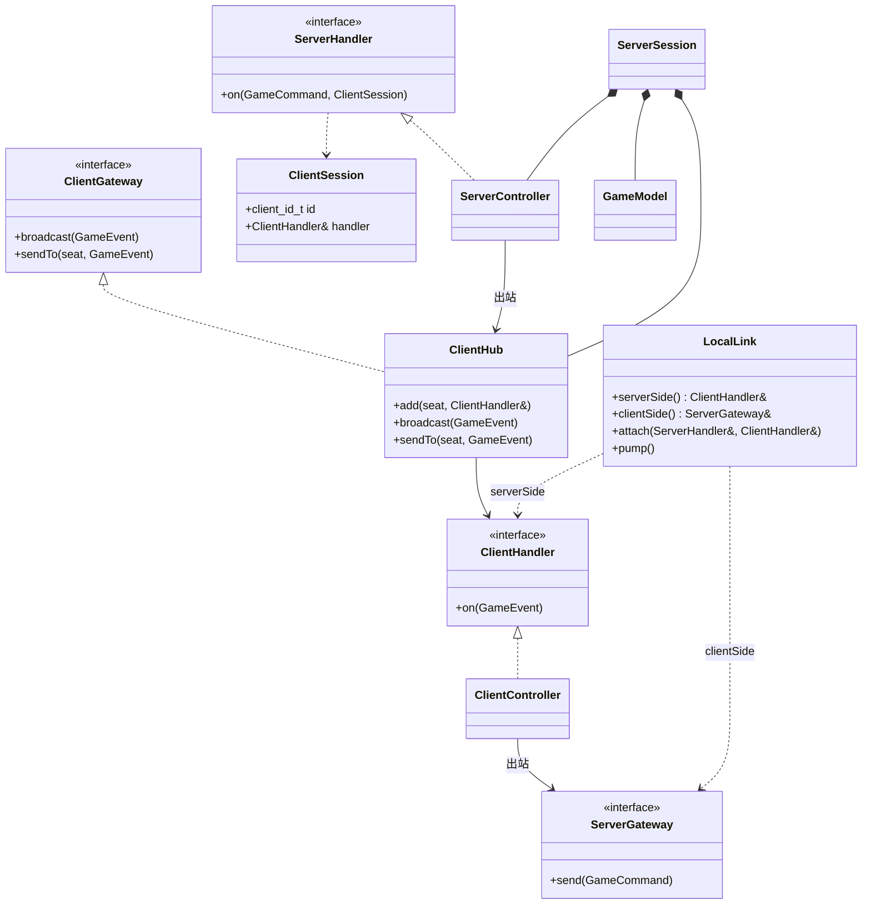

# ARCHITECTURE

> OpenHoldem 架构地图（以当前代码为准）。
> 设计的**过程与取舍**见 `docs/design/`；待办见 `docs/roadmap.md`。

## 1. 分层与目录

```
core/                         # 纯领域，不依赖网络/序列化/表现
    algo/       # 纯算法：eval_hand、side_pots、chips_calc；（草稿 betting）
    client/     # 客户端领域：ClientController / ClientModel / ClientView
    common/     # 值类型：Card、Deck、GameTypes、Player、PlayerSet、HandValue
    event/      # 事件/命令定义（Event.hpp）与 EventBus
    interface/  # 端口：ClientGateway/ServerGateway、ClientHandler/ServerHandler、ClientHub、LocalLink、Logger
    model/      # 领域模型：BettingRound、CardsManager、PotManager、SeatManager
    server/     # 服务端：ServerSession（组合根）、ServerController、GameModel

application/                  # 应用层（当前暂缓，部分编译不过）
    logging/        # Logger 实现（spdlog）
    network/        # SFML 网络适配器（RemoteServer / RemoteClient 待重写）
    presentation/   # 控制台表现
    serialization/  # nlohmann/json 序列化
```

依赖方向：`application → core`；**core 不反向依赖 application**。core 需要外部能力时定义**端口**（`ClientGateway`/`ServerGateway`/`ClientHandler`/`ServerHandler`/`IDeck`/`Logger`），由应用层实现。

## 2. 两端接口（核心抽象）



| 组件 | 职责 |
|---|---|
| `ClientGateway` | **服务器出站**接口：`broadcast(event)` / `sendTo(seat, event)` |
| `ServerGateway` | **客户端出站**接口：`send(command)`（**不带身份**） |
| `ClientHandler` | **客户端入站**接口：`on(GameEvent)`（实现内用 `std::visit` 分发） |
| `ServerHandler` | **服务器入站**接口：`on(GameCommand, ClientSession)` |
| `ClientSession` | `{ client_id_t id; ClientHandler& handler; }`，由**服务器侧适配器**提供 |
| `ServerController : ServerHandler` | 服务端状态机；经 `ClientGateway`（`ClientHub`）出站；不依赖 `EventBus` |
| `ClientHub : ClientGateway` | 按 `seat` 保存**非拥有** `ClientHandler*`；实现 `broadcast` / `sendTo` |
| `ClientController : ClientHandler` | 客户端投影：服务器事件 → `ClientModel`；持有 `ServerGateway&` 发命令 |
| `LocalLink` | 本地**异步双向 FIFO** 回环：`serverSide()`=ClientHandler、`clientSide()`=ServerGateway；带 `client_id` |
| `ServerSession` | 服务端**组合根**：持有 `ClientHub` + 各 manager + `GameModel` + `ServerController` |

## 3. 服务端组合根

```
ServerSession
├── ClientHub
├── PlayerSet
├── SeatManager
├── BettingRound
├── CardsManager
├── PotManager
├── GameModel ──(引用)──▶ 上述组件
└── ServerController ──(引用)──▶ ClientHub + GameModel
```

`ServerSession` 拥有全部组件并负责构造顺序；`IDeck` 由外部注入（测试可注入 `MockDeck`）。

## 4. 数据流

**入站（客户端命令 → 服务器）**

```
ClientController ──ServerGateway::send(command)──▶ (LocalLink/网络) ──补 ClientSession──▶ ServerHandler::on ──▶ ServerController ──▶ GameModel
```

**出站（服务器事件 → 客户端）**

```
ServerController ──ClientGateway::broadcast/sendTo──▶ (ClientHub) ──▶ ClientHandler::on(event)
```

- 公开事件（`GameStarted` / `StageChanged` / `BlindPosted` / `PlayerActed` / `PotAwarded` …）→ `broadcast`
- 私密信息（`HoleCardsDealt`）→ `sendTo(seat)`
- 需要行动（`TurnStarted`）→ `sendTo(seat)`
- 摊牌（`HoleCardsRevealed`）→ `broadcast`

**本地回环（demo / 测试）**

```
LocalLink:  ServerController ◀─ serverSide()(ClientHandler) ⇄ clientSide()(ServerGateway) ─▶ ClientController
            端点只入队；pump() 统一投递两个方向
```

**网络（待做）**：`NetworkServerGateway` 实现 `ServerGateway`（客户端出站）；服务器侧监听把每条连接包装成 `ClientSession`，出站由 `ClientGateway` 的实现（如 `NetworkClientGateway`）负责。

## 5. 协议（`Event.hpp`）

- **命令 `Command::`（客户端 → 服务器）**
  `JoinRequest {uid}` · `StartGame {big_blind, initial_chips}` · `SubmitAction {target_bet, is_fold}`
  - 变体：`GameCommand = std::variant<Command::JoinRequest, Command::StartGame, Command::SubmitAction>`
- **事件 `Event::`（服务器 → 客户端）**
  `JoinResponse` · `PlayerJoined` · `GameStarted` · `HoleCardsDealt` · `StageChanged` · `BlindPosted` · `CommunityCardsDealt` · `TurnStarted` · `PlayerActed` · `HoleCardsRevealed` · `PotAwarded` · `UncalledBetReturned` · `GameEnded`
  - 变体：`GameEvent`
- 两端统一入口：`ClientHandler::on(const GameEvent&)`、`ServerHandler::on(const GameCommand&, const ClientSession&)`；实现内部用 `std::visit` 分发到 `handle` 重载。
- **身份**：`ClientSession { client_id_t id; ClientHandler& handler; }` 由**服务器侧适配器**提供；客户端 `ServerGateway::send(command)` **不带身份**。
- `GameEvent`（variant）仍保留，供**序列化 / 日志**使用；核心传输接口用强类型回调，不依赖 variant。
- ⚠️ 当前 `TurnStarted` 仍携带派生字段（`player_chips` / `player_bet` / `round_bet` / `min_raise` / `can_raise`），与"只传事实"的方向不一致，属**临时保留**（见 `docs/design/event-protocol.md`）。

## 6. 关键类型

| 类型 | 职责 |
|---|---|
| `ServerController` | 状态机：`enterStage` / `enterPreflop` / `enterPostflop` / `enterShowdown` / `enterSettlement`；纯决策 `decideAfterBettingRound()` |
| `GameModel` | 领域规则与状态；方法**返回事件**，不发布 |
| `BettingRound` | 一轮下注：金额、行动顺序、`applyAction(Command::SubmitAction) -> optional<PlayerActed>` |
| `Player` | 筹码 / all-in 的**唯一入口**：`payChips` / `winChips` / `commit` / `refund`（含 `assert`） |
| `PotManager` | 主池 / 边池 |
| `SeatManager` | 座位 / 按钮 / 行动顺序 |
| `CardsManager` | 牌堆、公共牌、发牌 |
| `Deck` | 可播种（`Deck(seed)`） |
| `ClientModel` | 客户端展示状态（扁平结构；待收敛，见 roadmap） |
| `ClientView` / `NullClientView` | 展示接口 / 空实现 |

## 7. 关键不变量

- all-in 是**玩家状态**，不是动作意图；由 `Player` 维护 `ALL_IN` / `ACTIVE`。
- `Action` 枚举 CamelCase：`Void / Fold / Check / Call / Bet / Raise / Undercall / ShortAllIn`。
- 未跟注筹码在**每次下注轮结束**时退还。
- **无人竞争**（alive==1）时整池直接判给唯一存活者，不切分底池。
- 摊牌：任一人 all-in → 一次全亮（TDA 16）；否则从河牌轮最后激进者（无则按钮左侧）起顺时针（TDA 17）。
- 结算后清零 `committed`。

## 8. 当前状态

| 目标 | 状态 | 说明 |
|---|---|---|
| `poker_core` | ✅ | 核心静态库 |
| `poker`（demo） | ✅ | 本地回环：1 个 `ClientController` + 若干 bot，`./poker [seed]` |
| `poker_test` | ✅ | 76 个用例全绿 |
| 应用层目标 | ⚠️ | `src/server_main.cpp` / `client_main.cpp` 仍引用已删除的 `*IoAdapter.h`；序列化/表现待对齐 |
| `betting.h`（意图模型） | 🧪 | 已实现 `process(Fold/Check/Call/Bet/Raise/AllIn)`，**尚未接入引擎**（引擎仍用 `SubmitAction{target_bet,is_fold}`） |
