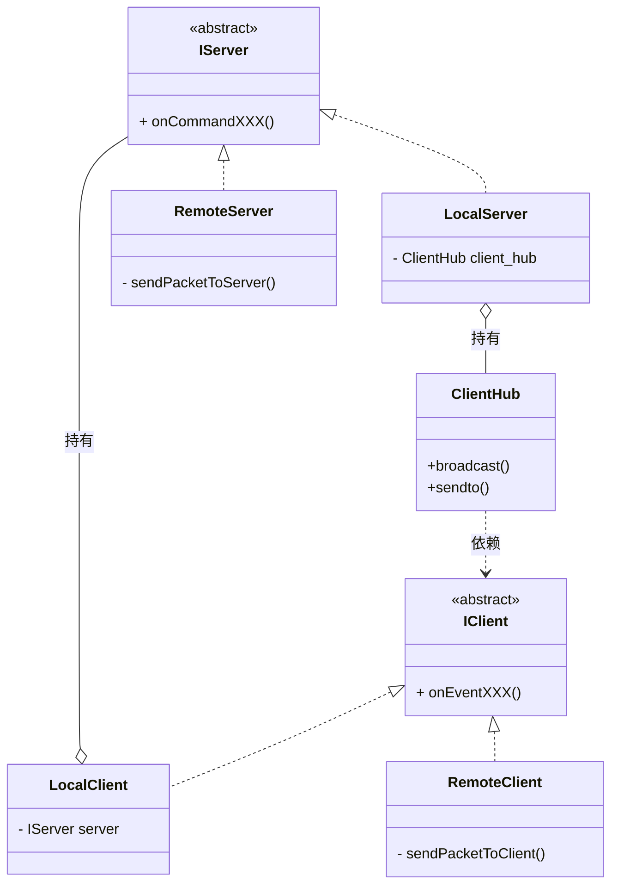

# 关于加入 IGameServer / IGameClient 的想法

> 注（后续演进）：实际实现已演化为 **4 端口**：`ClientGateway` / `ServerGateway`（出站）+ `ClientHandler` / `ServerHandler`（入站）；`ServerHandler::on` 的 sender 由服务器侧适配器补。本文的逐事件 `onXxx` 仅作历史设计记录。见 `docs/architecture.md`。



注：LocalServer/LocalClient 实际上是 ServerController/ClientController

在服务器，架构和出口事件流向：
```
LocalServer -实现-> IServer
LocalServer -持有-> ClientHub
调用 ClientHub::broadcast() 或 sendto()
传递 &IClient::onXXX
ClientHub 调用 IClient::onXXX()
    如果是内联测试：LocalClient
    如果是网络通信：RemoteClient
```

在客户端，架构和出口事件流向：
```
LocalClient -实现-> IClient
LocalClient -持有-> IServer
    如果是内联测试：LocalServer
    如果是网络通信：RemoteServer
LocalClient 调用 IServer::onXXX
```